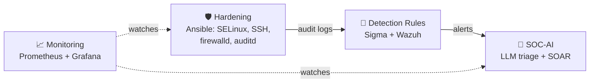

<h1 align="center">Hi, I'm Jawher 👋</h1>
<h3 align="center">Cybersecurity Engineer · SOC Analysis · Linux & System Administration</h3>

  📍 Tunisia &nbsp;|&nbsp; 🗣️ Arabic · French · English

  
  
  

---

## 🛡️ About me

Cybersecurity engineer with a networks & systems background, working at the intersection of **security operations** and **infrastructure administration**. I harden the systems I manage, build the detections that watch them, and automate the response.

- 🔎 **Security operations:** alert triage, log analysis, phishing and malware investigation, IOC enrichment, MITRE ATT&CK mapping
- 🎯 **Detection engineering:** Sigma rules and native Wazuh rules, unit-tested against real attack and benign logs
- 🖥️ **System administration:** Linux / Red Hat administration, Ansible automation, network services, NOC supervision
- 📡 **Monitoring:** Prometheus, Grafana and Alertmanager; infrastructure supervision with Nagios in a banking environment (Société Tunisienne de Banque)
- 🏢 **Production experience:** IT Support Technician at Innova Soft: NOC supervision, ticketing, Linux/Red Hat admin, network services
- 🤖 **Builder:** creator of **SOC-AI**, an AI-enhanced SOC platform with LLM triage and human-approved SOAR containment

---

## 🧰 Technical stack

### 🔐 Security operations
**SIEM & detection:** Wazuh · Splunk · ELK Stack · Sigma · Suricata 
**Network security:** Wireshark · Snort · Zeek · FortiGate 
**Endpoint & logs:** Sysmon · Windows Event Logs · Linux auditd / syslog 
**Threat intel:** VirusTotal · AbuseIPDB · AnyRun · URLScan 
**SOAR & automation:** n8n · Python · LLM-assisted triage 
**Frameworks:** MITRE ATT&CK · Cyber Kill Chain · Pyramid of Pain

### 🖥️ System & network administration
**Operating systems:** Red Hat / RHEL · Linux · Windows Server / Active Directory 
**Hardening:** SELinux · firewalld · SSH · sysctl · auditd 
**Services:** DNS · DHCP · SSH · Apache / Nginx · user & permission management 
**Networking:** TCP/IP · routing & switching · VLANs · firewalls 
**Monitoring:** Prometheus · Grafana · Alertmanager · Nagios 
**Automation & DevOps:** Ansible · Bash · Docker · Git · GitHub Actions · CI/CD

  

---

## 📂 Featured projects

| Project | Area | Description |
|---|---|---|
| [**SOC-AI**](https://github.com/jawherxxd/Soc-AI) | SOC / SOAR | AI-enhanced SOC: Wazuh + Suricata alerts correlated and triaged by an LLM, enriched with threat intel, with human-approved FortiGate containment via n8n |
| [**Detection Rules**](https://github.com/jawherxxd/detection-rules) | Detection engineering | 13 Sigma rules (Linux auditd + Active Directory) unit-tested in CI, mapped to MITRE ATT&CK v19, with native Wazuh rules and Splunk / Wazuh queries |
| [**Ansible Linux Production Hardening**](https://github.com/jawherxxd/ansible-linux-production-hardening) | SysAdmin / Security | Lockout-safe RHEL hardening: SSH, SELinux, firewalld, sysctl, auditd mapped to MITRE ATT&CK, auto-updates, and a PASS/FAIL compliance report |
| [**Infra Monitoring Stack**](https://github.com/jawherxxd/infra-monitoring) | SysAdmin / Monitoring | Hardened Prometheus + Grafana + Alertmanager stack: 25 unit-tested alerts (security controls, SELinux, SOC-AI dead-man's switch), Telegram alerts, node_exporter Ansible role |

### 🔗 How they fit together

---

## 🎓 Education

- **Engineering degree in Cybersecurity** – Tek-Up University
- **Licence en Technologie de l'Informatique**, Networks & Computer Systems – ISET Tozeur (2019–2022)

---

## 💼 Open to

**SOC Analyst** · **System Administrator** · **Security / Infrastructure Engineer** roles in Tunisia or remote, with French or English-speaking teams.

  

